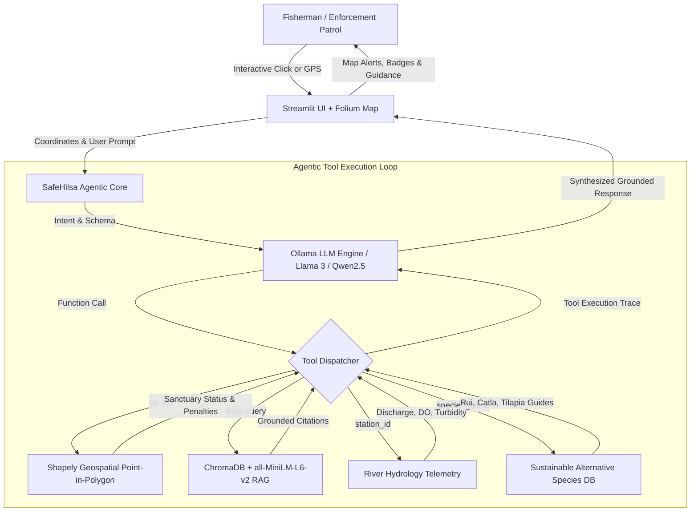

# 🐟 SafeHilsa AI: Local-First Agentic Compliance & Riverine Conservation Guardian

[](https://opensource.org/licenses/MIT)
[](https://python.org)
[](https://streamlit.io)
[](https://trychroma.com)
[-black.svg)](https://ollama.com)
[-brightgreen.svg)]()

> **Protecting the Queen of Fish (*Tenualosa ilisha*) across the Ganges-Bhagirathi-Hooghly delta.**  
> SafeHilsa AI is an open-source, local-first Agentic AI & RAG system designed for Hilsa fish conservation and compliance in riverine areas (West Bengal & Bangladesh). It empowers artisanal fishermen and enforcement teams to avoid illegal sanctuaries (such as juvenile 'Jatka' zones and breeding grounds), stay compliant with size limits (> 25 cm) and seasonal bans, and navigate toward safe, legal waters and sustainable alternative species (Rui, Catla, Tilapia).

---

## 🧭 Architecture Overview



---

## 🌟 Key Capabilities

1. **🗺️ Geospatial Sanctuary Radar:**
   - Vector overlays of designated Hilsa sanctuaries (Farakka Barrage, Katwa-Nabadwip, Diamond Harbour - Sagar Island, Sundarbans).
   - High-performance Shapely Point-in-Polygon checks to determine whether coordinates are **RESTRICTED** or **SAFE**.
   - Calculates distance to nearest safe landing ghat or sanctuary buffer.

2. **🤖 Agentic Function-Calling Loop (Ollama):**
   - Autonomous multi-turn tool calling using local models (`llama3.2`, `llama3`, `qwen2.5`).
   - Automatically invokes geospatial verification, regulatory search, or environmental metrics based on conversation intent.
   - Includes an intelligent deterministic fallback agent if Ollama is offline.

3. **📚 Local RAG Regulatory Engine (ChromaDB + Sentence Transformers):**
   - Embeds official West Bengal Inland Fisheries Acts (1984, 2013, 2015 amendments).
   - Retrieves authoritative citations for the **25 cm legal minimum catch size**, seasonal ban windows (October peak spawning & March-April Jatka vigil), and banned gear (monofilament "Current Jal").

4. **🌊 River Hydrology & Environmental Telemetry:**
   - Real-time telemetry simulation for Farakka Barrage, Kolkata Hooghly, Diamond Harbour, and Sagar Island.
   - Monitors water discharge (cumecs), Dissolved Oxygen (DO mg/L), turbidity, and salinity to forecast upstream migration suitability.

5. **🐟 Sustainable Alternative Species Navigation:**
   - Comprehensive harvesting guide for non-protected species (Rui, Catla, Mrigal, Tilapia, Pangas, Bata).
   - Directs fishermen to legal commercial species during ban windows to protect artisanal livelihoods.

6. **🛡️ 100% Free & Open-Source:**
   - **No paid Google Maps API keys** (uses Folium + OpenStreetMap vector tiles).
   - **No paid OpenAI / Anthropic / Gemini API keys** (runs 100% on local Ollama).
   - **Zero cloud egress** (local ChromaDB vector persistence).

---

## 📁 Repository Structure

```
safehilsa_app/
│
├── app.py                 # Streamlit UI (Map, Chat interface, Dashboard)
├── agent.py               # Ollama Agentic tool-calling loop & reasoning system
├── rag_engine.py          # ChromaDB setup, document indexing, and retrieval functions
├── tools.py               # Python functions executed by the LLM Agent
├── data/
│   ├── regulations.md     # Official West Bengal fisheries laws, size limits (>25cm), & ban periods
│   └── sanctuaries.geojson # GeoJSON polygons for river sanctuaries (Farakka, Padma, Hooghly)
├── requirements.txt       # All necessary Python packages
└── README.md              # Project setup and hackathon presentation guide
```

---

## ⚡ Quickstart Guide

### 1. Prerequisites & Virtual Environment
Ensure you have Python 3.10+ installed:

```bash
# Clone or navigate to the repository
cd safehilsa_app

# Create and activate virtual environment
python -m venv venv
# Windows:
venv\Scripts\activate
# Linux/macOS:
source venv/bin/activate

# Install dependencies
pip install -r requirements.txt
```

### 2. Set Up Local Ollama (Recommended)
Download and install [Ollama](https://ollama.com):

```bash
# Pull your preferred local model:
ollama pull llama3.2
# or
ollama pull qwen2.5

# Start Ollama service:
ollama serve
```

> **Note:** SafeHilsa AI includes a robust deterministic fallback agent. If Ollama is not installed or offline, the application continues to run seamlessly using deterministic tool execution.

### 3. Launch SafeHilsa AI Dashboard
Run the Streamlit application:

```bash
streamlit run app.py
```
Open your browser at `http://localhost:8501`.

---

## 🎤 Hackathon Presentation & Live Demo Script

Follow this 3-minute pitch scenario to impress hackathon judges:

### Scene 1: The Sanctuary Breach Trap (Geospatial Compliance)
- **Action:** In the left column, click the **📍 Farakka Barrage** quick button (Coordinates: `24.8100°N, 87.9250°E`).
- **Observation:** Notice the map immediately highlights the red restricted polygon. The alert banner turns **RED: RESTRICTED SANCTUARY DETECTED**.
- **Chat Query:** Click the prompt chip *"🧭 Is my GPS location legal to fish?"*
- **Agent Action:** The agent executes `check_location_compliance(lat=24.81, lon=87.925)`. A tool execution badge appears with expandable telemetry.
- **Judge Impact:** Shows how fishermen receive instant, clear directives to evacuate and avoid boat impoundment under Section 23 of the West Bengal Inland Fisheries Act.

### Scene 2: The 25 cm Catch Rule (RAG Grounding)
- **Chat Query:** Click *"📏 Minimum legal catch size?"*
- **Agent Action:** The agent invokes `search_regulations_tool(query="minimum legal catch size")`.
- **Observation:** SafeHilsa AI cites the exact statutory rule: any Hilsa smaller than **25 cm** is classified as **Jatka**, and catching or marketing it carries criminal fines and net destruction.
- **Judge Impact:** Shows how the local RAG engine grounds responses without hallucinations or cloud fees.

### Scene 3: Sustainable Livelihood Transition (Alternative Species)
- **Chat Query:** Click *"🐟 What alternative fish can I catch?"*
- **Agent Action:** The agent executes `get_alternative_species_info(species_name="all")`.
- **Observation:** The assistant outputs market prices, permissible gear, and harvesting tips for **Rui, Catla, and Tilapia**, plus mentions the government 40 kg/month food security assistance (VGF scheme).
- **Judge Impact:** Proves that conservation does not harm artisanal fishermen—it directs them toward sustainable livelihoods.

---

## 🌊 Ecological Impact & UN SDG Alignment

- **UN SDG 14: Life Below Water:** Prevents the collapse of anadromous Hilsa broodstock, combating overfishing and destructive monofilament gill netting.
- **UN SDG 1: No Poverty & SDG 8: Decent Work:** Prevents heavy fines, boat seizures, and debt cycles for artisanal fishermen by ensuring compliance and providing alternative catch strategies.
- **Cross-Border River Diplomacy:** Aligns West Bengal regulations with Bangladesh's renowned Jatka conservation framework for synchronized ecosystem protection.

---

## 📜 Legal & Compliance Disclaimer
*SafeHilsa AI is an open-source educational and compliance tool. GPS coordinates, sanctuary boundaries, and hydrological telemetry are derived from published notifications under the West Bengal Inland Fisheries Act, 1984 (as amended) and public river observatories. Always verify official notifications with local State Fisheries Extension Officers before navigating.*
